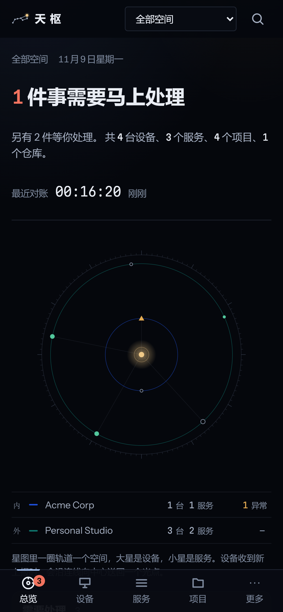
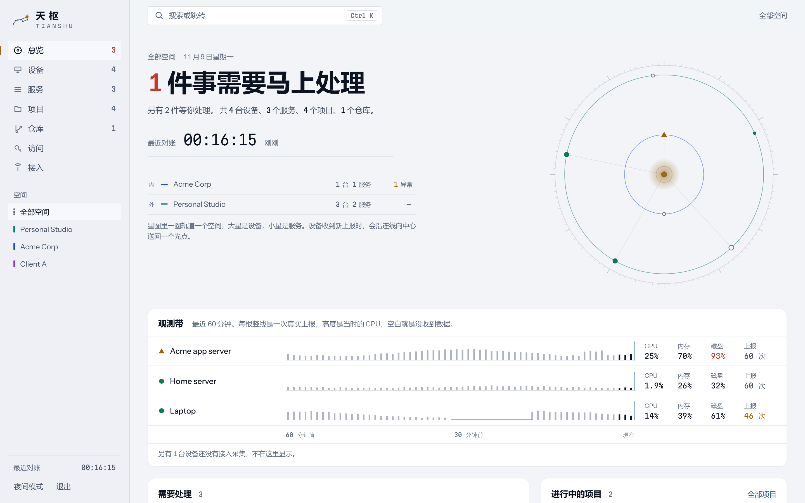
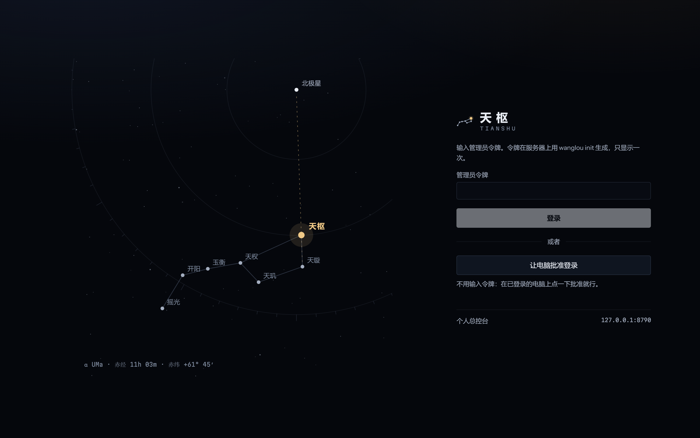
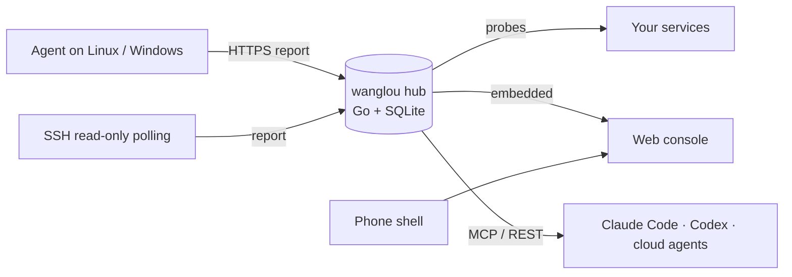

<div align="center">


# Tianshu 天枢

**A self-hosted control plane for one person's servers, devices, services, projects and repositories — with a read-only MCP server so AI agents can see what you see.**

[English](README.md) · [简体中文](README.zh-CN.md) · [繁體中文](README.zh-TW.md) · [日本語](README.ja.md) · [한국어](README.ko.md) · [Español](README.es.md) · [Français](README.fr.md) · [Deutsch](README.de.md) · [Português](README.pt-BR.md) · [Русский](README.ru.md)

[](https://github.com/Feianxc/tianshu/actions/workflows/ci.yml)
[](LICENSE)


</div>


Tianshu (天枢, *Dubhe*, the first star of the Big Dipper) is a single Go binary with an embedded web console. It answers one question at a glance: **does anything need me right now?** It keeps a catalog of what you own, collects real evidence about its state, turns that into a short list of findings, and exposes the same read model to AI agents over the [Model Context Protocol](https://modelcontextprotocol.io).

It is built for people who run a personal homelab, a few cloud servers, side projects and client work at the same time, and who want company and personal data kept apart.

## Features

- **One screen for everything** — devices, services, projects, repositories and credential *references* across several workspaces (personal, company, clients).
- **Live star map** — every workspace is an orbit, every device and service a star; shape and color encode health. A pulse travels to the center whenever a host reports.
- **Telemetry strip** — the last 60 minutes per host, one tick per real report, height = CPU. Gaps show up as gaps, never as "OK".
- **Evidence over assumptions** — health, freshness, lifecycle and acceptance are tracked separately. Stale data is never shown as healthy; security exposure (e.g. SSH password login) never paints a healthy host yellow.
- **Findings that clean themselves up** — rules turn signals into a deduplicated to-do list that closes automatically once the problem is gone. Snooze for a day, a week or a month.
- **Collectors** — a small agent for Linux and Windows (host metrics, systemd units, listening ports, local Git repositories), or read-only SSH polling for hosts where you cannot install anything. HTTP/TCP/TLS probes run from the hub.
- **Logs and diagnosis** — collectors send journal lines at warning level or worse and the last lines of failed units; every finding comes with a playbook (what it means, steps, read-only commands). A log terminal and a diagnosis panel on each device and service page.
- **SSH exposure monitoring** — effective `sshd -T` settings, failed logins in the last hour, fail2ban state and authorized key fingerprints. A key added after the baseline is a critical finding.
- **MCP server for AI agents** — `overview`, `search`, `get_entity`, `project_context`, `device_context`, `list_findings`, `diagnose`, `logs`, `access_options`, `submit_evidence`. Log text needs a separate `logs` permission. Bearer tokens for Claude Code and Codex, OAuth 2.1 (PKCE, dynamic registration, CIMD) for cloud clients.
- **Workspace isolation built in** — every request is resolved to a viewer from its credential alone; objects in other workspaces return 404; per-workspace cloud policy (`allow`, `summary`, `deny`) decides what agents may see.
- **No secrets inside** — the catalog stores only *where* a credential lives; values that look like secrets are refused. Tokens are stored as hashes. Every agent call is audited.
- **Device pairing** — sign in on a phone without typing a token: approve the request on a computer that is already signed in, after checking that both screens show the same code.
- **Phone status** — the Android app can report battery, network, memory and storage every 15 minutes with a token that can only report for that phone.
- **Command palette** (`Ctrl K`), dark and light themes, mobile layout, and a tiny Android WebView shell.

<table>
  <tr>
    <td></td>
    <td><br></td>
  </tr>
</table>

> The console UI is currently in Simplified Chinese. API, MCP tool descriptions and these docs are available in English.

## Quick start

Requirements: Go 1.27+, Node.js 20+.

```bash
git clone https://github.com/Feianxc/tianshu.git
cd tianshu
bash scripts/build.sh               # builds the console, runs tests, builds binaries into .build/

export WANGLOU_DATA=./data
.build/wanglou import examples/catalog   # optional: fictional demo data
.build/wanglou init                      # prints the admin token once
.build/wanglou serve                     # http://127.0.0.1:8787
```

On Windows, `dev-start.cmd` starts the hub and a local collector, restarting either if it exits.

Then install a collector on each host (see [Deployment](docs/DEPLOYMENT.md)) and connect an agent:

```bash
claude mcp add --transport http tianshu https://tianshu.example.com/mcp \
  --header "Authorization: Bearer $WANGLOU_TOKEN"
```

## How it fits together



Read the [architecture notes](docs/ARCHITECTURE.md) for the data model, status rules and security model.

## Documentation

| | |
|---|---|
| [Architecture](docs/ARCHITECTURE.md) | Data model, status rules, isolation, MCP, OAuth |
| [Deployment](docs/DEPLOYMENT.md) | systemd, Cloudflare Tunnel + Access, collectors, backups, upgrades |
| [Android shell](mobile/android/README.md) | Build a small WebView app without Gradle |
| [Example catalog](examples/catalog/demo.yaml) | The YAML format, with fictional data |
| [Security policy](SECURITY.md) | How to report a vulnerability |
| [Contributing](CONTRIBUTING.md) | Development setup and conventions |

## Project status

Used daily by its author on a small fleet of servers, laptops and a phone. The program and environment variables still use the original name `wanglou` (望楼, "watchtower"); the product was renamed to Tianshu. Expect breaking changes before 1.0.

## License

[MIT](LICENSE) © 2026 Feianxc
