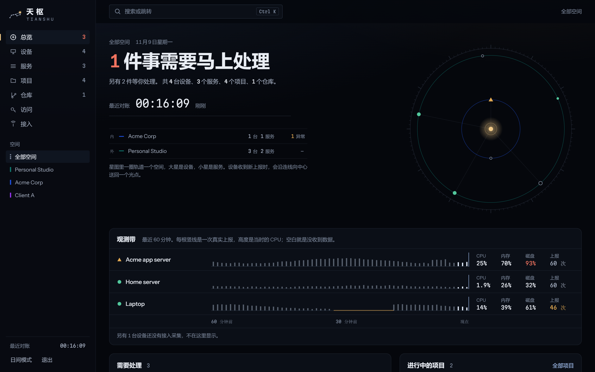
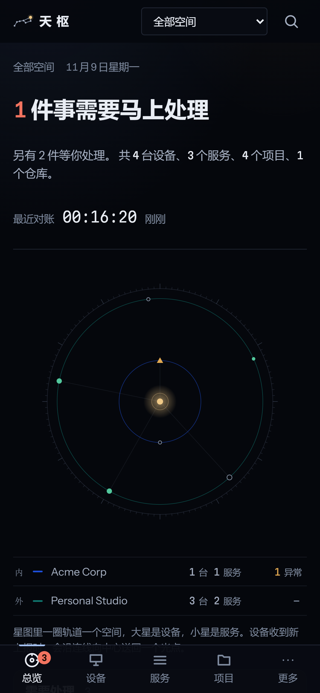
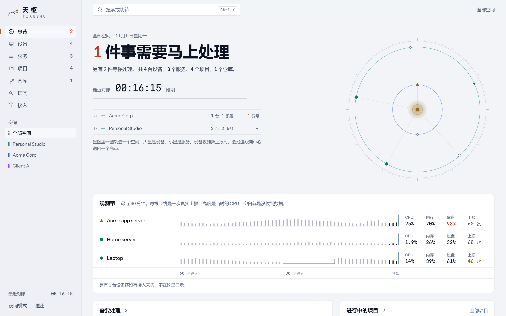
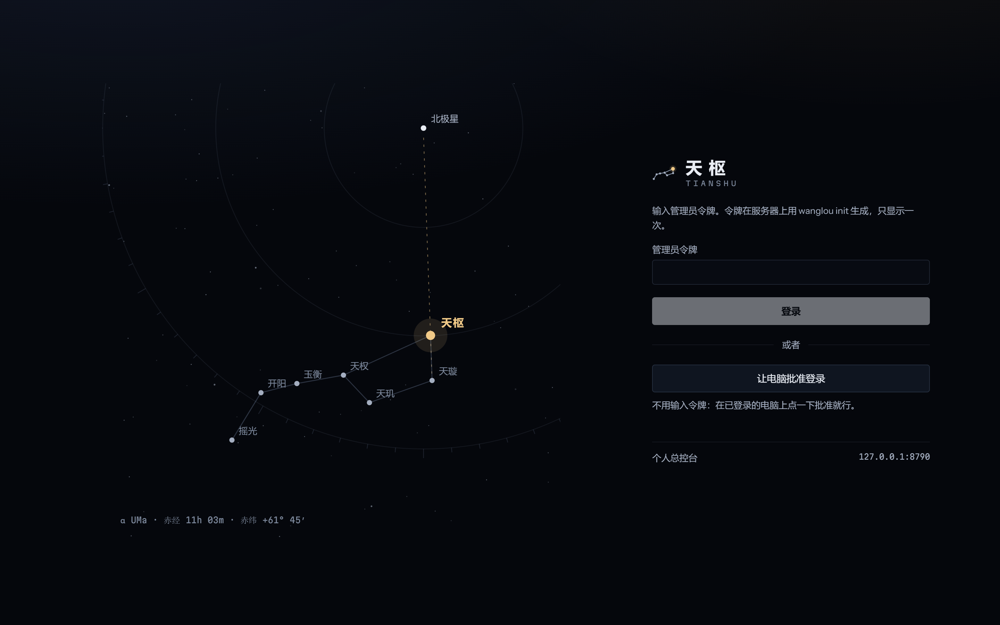

<div align="center">


# 天枢 Tianshu

**自托管的个人总控台：一屏看清你所有的服务器、设备、服务、项目和代码仓库，并通过只读的 MCP 服务让 AI Agent 看到和你一样的全局。**

[English](README.md) · [简体中文](README.zh-CN.md) · [繁體中文](README.zh-TW.md) · [日本語](README.ja.md) · [한국어](README.ko.md) · [Español](README.es.md) · [Français](README.fr.md) · [Deutsch](README.de.md) · [Português](README.pt-BR.md) · [Русский](README.ru.md)

[](https://github.com/Feianxc/tianshu/actions/workflows/ci.yml)
[](LICENSE)

</div>



天枢是北斗七星的第一颗，古人沿着它找到北极星。这个项目是一个 Go 单文件程序，内嵌网页控制台，只回答一个问题：**现在有没有事需要我出手？** 它维护一份“你拥有什么”的目录，收集每样东西真实状态的证据，归并成一份简短的待处理清单，再把同一套只读数据通过 [Model Context Protocol](https://modelcontextprotocol.io) 提供给 AI Agent。

适合同时维护个人服务器、几台云主机、副业项目和客户项目的人，并且要求公司和个人的资料分开。

## 功能

- **一屏看全局**：设备、服务、项目、仓库和凭据**引用**，按空间（个人、公司、客户）分开。
- **实时星图**：每个空间一圈轨道，每台设备和每个服务是一颗星，形状和颜色就是健康状态；主机每上报一次，就有一个光点沿连线回到中心。
- **观测带**：每台主机最近 60 分钟，每根竖线是一次真实上报，高度是 CPU。没收到数据就是空白，不会显示成“正常”。
- **只认证据**：健康、新鲜度、生命周期、验收结论分开记录。过期的数据不算健康；SSH 允许密码登录这类暴露面只产生待处理事项，不把正常运行的主机涂黄。
- **会自己消失的待处理**：规则把信号归并成去重后的清单，问题解决后自动关闭；可以推迟一天、一周或一个月再提醒。
- **采集器**：Linux 和 Windows 上的小程序（主机指标、systemd 单元、监听端口、本地 Git 仓库），不能装软件的主机可以用只读 SSH 采集；HTTP、TCP、TLS 探测从天枢所在的位置发出。
- **日志与诊断**：采集器上报警告及以上级别的系统日志和失败单元的最后几行；每条待处理都配有处理步骤（含义、做法、只读排查命令）。设备和服务页有日志终端和诊断面板。
- **SSH 登录入口监控**：`sshd -T` 的实际生效值、近 1 小时失败登录、fail2ban 状态、能登录的钥匙指纹；开始观察之后新增的钥匙是紧急事项。
- **给 AI Agent 的 MCP 服务**：`overview`、`search`、`get_entity`、`project_context`、`device_context`、`list_findings`、`diagnose`、`logs`、`access_options`、`submit_evidence`。读取日志原文需要单独的 `logs` 权限。Claude Code、Codex 用 Bearer 令牌，云端客户端用 OAuth 2.1（PKCE、动态注册、CIMD）。
- **空间隔离**：每个请求的身份只从凭据解析；看不到的对象一律 404；每个空间单独设置云端策略（`allow`、`summary`、`deny`），决定 Agent 能看到什么。
- **不存秘密**：目录只记录凭据放在哪里，像密码或密钥的值会被拒绝；令牌只存哈希；Agent 的每次调用都留审计。
- **设备配对登录**：手机上不用输令牌，在已登录的电脑上核对两边代码一致后点批准即可。
- **手机状态**：安卓应用可每 15 分钟上报电量、网络、内存和存储，用的令牌只能为这部手机上报。
- **命令面板**（`Ctrl K`）、夜间和日间模式、手机布局，以及一个很小的安卓 WebView 壳。

<table>
  <tr>
    <td></td>
    <td><br></td>
  </tr>
</table>

截图里的数据全部是虚构的演示数据。

## 快速开始

需要 Go 1.27+、Node.js 20+。

```bash
git clone https://github.com/Feianxc/tianshu.git
cd tianshu
bash scripts/build.sh               # 构建控制台、跑测试、把程序输出到 .build/

export WANGLOU_DATA=./data
.build/wanglou import examples/catalog   # 可选：导入虚构的演示数据
.build/wanglou init                      # 生成管理员令牌，只显示一次
.build/wanglou serve                     # http://127.0.0.1:8787
```

Windows 上双击 `dev-start.cmd`，会启动天枢和本机采集器，任何一个退出都会自动重启。

然后在每台主机上装采集器（见[部署](docs/zh-CN/DEPLOYMENT.md)），再接入 Agent：

```bash
claude mcp add --transport http tianshu https://tianshu.example.com/mcp \
  --header "Authorization: Bearer $WANGLOU_TOKEN"
```

## 文档

| | |
|---|---|
| [架构](docs/zh-CN/ARCHITECTURE.md) | 数据模型、状态规则、空间隔离、MCP、OAuth |
| [部署](docs/zh-CN/DEPLOYMENT.md) | systemd、Cloudflare Tunnel 和 Access、采集器、备份、升级 |
| [安卓壳](mobile/android/README.md) | 不用 Gradle 打一个 17 KB 的 WebView 应用 |
| [示例目录](examples/catalog/demo.yaml) | YAML 格式，全部是虚构数据 |
| [安全策略](SECURITY.md) | 如何报告漏洞 |
| [参与开发](CONTRIBUTING.md) | 开发环境和约定 |

## 项目状态

作者每天用它管理几台服务器、笔记本和手机。程序名和环境变量仍沿用最初的名字 `wanglou`（望楼），产品已更名为天枢。1.0 之前可能有不兼容的改动。

## 许可证

[MIT](LICENSE) © 2026 Feianxc
