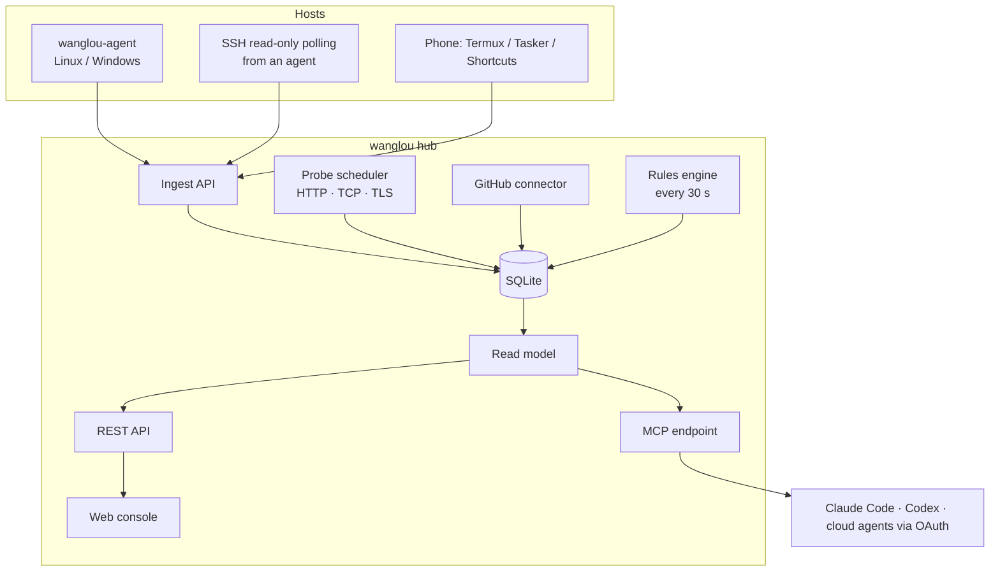

# Architecture

Tianshu is a modular monolith: one Go binary (`wanglou`) that serves the REST API, the MCP endpoint, the OAuth server and the embedded web console, plus a separate collector (`wanglou-agent`). State lives in a single SQLite file.

## Data model

| Object | What it is |
|---|---|
| Workspace | An authorization boundary (personal, company, client). Every object belongs to exactly one. Tags are for filtering only. |
| Device | A server, PC, phone, tablet, wearable, router or IoT device. |
| Service | A website, API, background job or piece of infrastructure. It may run on zero, one or several devices. |
| Project | Something you are building or maintaining. It may have no repository yet. Stage, priority, next step and blockers are yours to maintain. |
| Repository | A Git repository, synced from GitHub and from local clones. |
| Credential | A *reference*: where a key lives and how it is used. Never the key itself. |
| Relation | `runs_on`, `part_of`, `built_from`, `depends_on`, `uses`. Many-to-many. |
| Signal | One observation with a source, an observation time and a staleness limit. |
| Finding | A deduplicated issue produced by a rule, closed automatically when the condition clears. |
| Evidence | An acceptance record (`pass`, `fail`, `partial`, `blocked`, `not run`). A claim, never a state change. |

The catalog can be edited in the console or in YAML files (see [`examples/catalog`](../examples/catalog/demo.yaml)). Imports only update the fields present in the file, so edits made in the console survive.

## Status rules

Four dimensions are kept apart and never folded into a single green light:

- **Health** — `ok`, `degraded`, `down`, `unknown`.
- **Freshness** — `fresh`, `partial`, `stale`, `missing`. A stale signal stops counting as current state.
- **Lifecycle** — `active`, `paused`, `planned`, `retired`. Paused and retired objects never raise alarms.
- **Acceptance** — the latest evidence verdict. Running is not the same as accepted.

Other rules worth knowing:

- No evidence is not "OK". Hosts without signals are shown as unknown.
- Exposure is not health. Signals starting with `sec.` (currently the SSH entry point) produce findings but never turn a healthy host yellow.
- Disks are judged by free space, not only percentage, so a large disk with plenty of room is not an alarm.
- A late report never rolls state back; collectors are ordered by run ID and sequence, not by their clocks.
- A key that appears in `authorized_keys` after the first observation is a critical finding; the first observation is the baseline.

## Collectors

`wanglou-agent` reports every 30 seconds by default: CPU, memory, swap, load, network, disks, systemd units and the overall systemd state (Linux), listening ports, and optionally local Git repositories (dirty and unpushed counts). It only makes outbound requests and accepts no commands.

For hosts where nothing can be installed, an agent can poll over SSH. The script is sent over stdin and only reads `/proc`, `df`, `systemctl`, `ss`, `sshd -T`, `journalctl` counters and `ssh-keygen -lf`. It never writes.

Probes run from the hub; every result is stored together with the probe location (`WANGLOU_VANTAGE`), because reachability only means something from a known place.

## Logs and diagnosis

Collectors read the journal, never follow it: each round asks for lines at warning level or worse in a window that overlaps the previous one, plus the last 12 lines of up to five failed units. Identical lines are folded with a count; sshd chatter and firewall drop messages from scanners are left out. The hub masks anything that looks like a credential, a long opaque value or a mail address, keeps lines for 7 days and at most 4000 per device.

Who reads what:

- People who can see a workspace read its log text.
- Agents need the separate `logs` scope (granted at consent time, or later on the Access page), and only in workspaces with cloud policy `allow`. Otherwise they get counts of errors and warnings per unit, which still says where to look.
- A service shows only its own units. A host shows everything except units of services in workspaces the viewer cannot see.

`diagnose` (and the diagnosis panel) puts together the open findings with a playbook each — what it means, the steps, read-only commands for the owner to run — the recent probe history, the state of the hosts a service runs on, and the last day of warnings and errors.

## Security model

- **Credentials resolve to a viewer.** Every request carries a token or a session; the viewer (identity, scopes, visible workspaces, allowed devices) is derived from it and passed down to every store call. A workspace sent by the client can only narrow the view.
- **Isolation at the bottom.** Every store function that reads entities takes the viewer. Objects in other workspaces return 404, not 403. Cross-workspace relations show up as "restricted" with health only.
- **Cloud policy per workspace.** `allow` returns full fields to agents, `summary` returns an allow-listed subset, `deny` hides the workspace from agents entirely, even with a `*` token. Unknown values are treated as `deny`.
- **Agents are read-only.** Their maximum scopes are `read` and `evidence`. No tool executes commands, reads secrets or fetches arbitrary URLs.
- **No secrets in the catalog.** Values that look like passwords, private keys or tokens are refused. Tokens are stored as SHA-256 hashes and shown once.
- **Sessions.** Browser sessions are `HttpOnly`, `SameSite=Strict`, `Secure` behind HTTPS, and writes require an anti-forgery header. Sessions last 12 hours.
- **Device pairing.** A new device starts a request and shows an 8-character code; an administrator approves it on a signed-in device after comparing the code. The session is only issued when the new device polls with its own secret, once. Requests live in memory for 5 minutes and are rate-limited.
- **Audit.** Every agent call, login, pairing and change is recorded.

## MCP and OAuth

The MCP endpoint is `/mcp` (streamable HTTP). Tools: `overview`, `search`, `get_entity`, `project_context`, `device_context`, `list_findings`, `diagnose`, `logs`, `access_options`, `submit_evidence`. All of them go through the same read model and authorization as the console.

Local clients use bearer tokens created on the Access page. Cloud clients use OAuth 2.1 with PKCE (S256), dynamic client registration or Client ID Metadata Documents (fetched only from allow-listed hosts). Access tokens are opaque, hashed, bound to the resource and expire after one hour; refresh tokens rotate, and replaying one revokes the whole family. During consent you choose which workspaces the client may see.

## Retention

Raw samples and probe runs are kept for 30 days, resolved findings for 180 days, audit events for 365 days. Pruning runs every hour.
