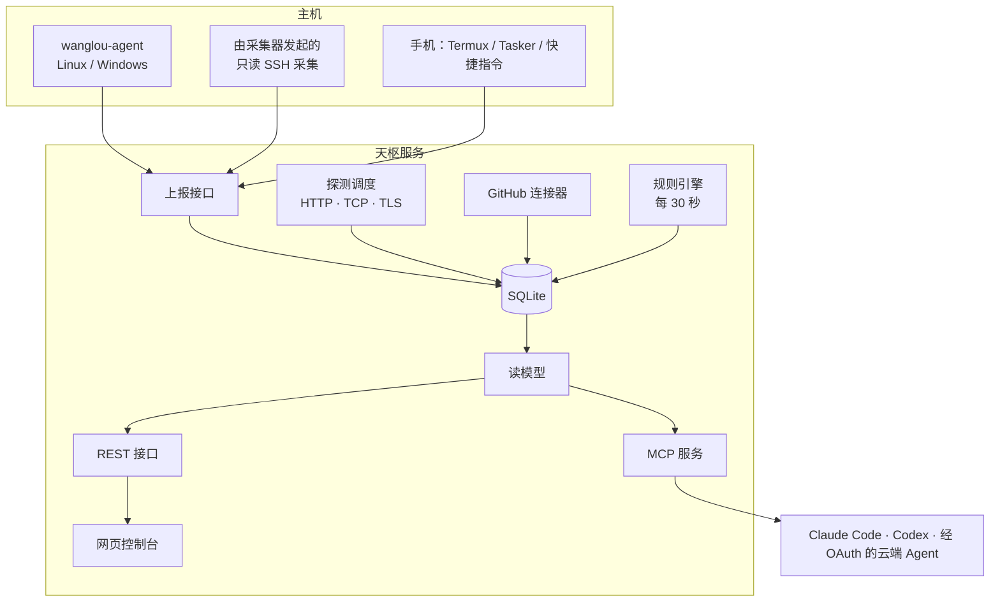

# 架构

天枢是一个模块化单体：一个 Go 程序（`wanglou`）同时提供 REST 接口、MCP 服务、OAuth 服务和内嵌的网页控制台，另有一个采集器（`wanglou-agent`）。所有状态存在一个 SQLite 文件里。

## 数据模型

| 对象 | 含义 |
|---|---|
| 空间 | 授权边界（个人、公司、客户）。每个对象只属于一个空间。标签只用于筛选。 |
| 设备 | 服务器、电脑、手机、平板、穿戴、路由器、物联网设备。 |
| 服务 | 网站、接口、后台任务或基础设施，可以运行在零台、一台或多台设备上。 |
| 项目 | 你在做或在维护的事，可以还没有仓库。阶段、优先级、下一步和阻塞由你维护。 |
| 仓库 | Git 仓库，来自 GitHub 和本地副本。 |
| 凭据 | **引用**：钥匙放在哪、怎么用。从不保存钥匙本身。 |
| 关系 | `runs_on`、`part_of`、`built_from`、`depends_on`、`uses`，多对多。 |
| 信号 | 一次观测，带来源、观测时间和过期时限。 |
| 待处理 | 规则产生的去重问题，条件消失后自动关闭。 |
| 验收证据 | 验收记录（`pass`、`fail`、`partial`、`blocked`、`not run`）。是声明，不改变状态。 |

目录可以在控制台里改，也可以写 YAML（见 [`examples/catalog`](../../examples/catalog/demo.yaml)）。导入只更新文件里写了的字段，控制台里的修改不会被覆盖。

## 状态规则

四个维度分开记录，不合并成一盏绿灯：

- **健康**：`ok`、`degraded`、`down`、`unknown`。
- **新鲜度**：`fresh`、`partial`、`stale`、`missing`。过期的信号不再算当前状态。
- **生命周期**：`active`、`paused`、`planned`、`retired`。暂停和退役的对象不报警。
- **验收**：最近一次验收结论。运行正常不等于验收通过。

另外几条：

- 没有证据不算正常，没有信号的主机显示为未知。
- 暴露面不算健康。`sec.` 开头的信号（目前是 SSH 登录入口）只产生待处理事项，不把正常运行的主机涂黄。
- 磁盘按剩余空间判断，不只看百分比，大磁盘还剩很多空间时不报警。
- 迟到的上报不会让状态倒退；采集器按运行编号和序号排序，不看它的时钟。
- 第一次观测时 `authorized_keys` 里已有的钥匙是基线，之后新增的钥匙是紧急事项。

## 采集器

`wanglou-agent` 默认每 30 秒上报一次：CPU、内存、交换区、负载、网络、磁盘、systemd 单元和整体状态（Linux）、监听端口，以及可选的本地 Git 仓库（未提交和未推送数量）。它只向外发请求，不接受任何命令。

不能装软件的主机可以由采集器通过 SSH 轮询。脚本经标准输入传过去，只读 `/proc`、`df`、`systemctl`、`ss`、`sshd -T`、`journalctl` 计数和 `ssh-keygen -lf`，不写任何东西。

探测从天枢所在的位置发出，结果和探测位置（`WANGLOU_VANTAGE`）一起保存，因为“能不能访问”只有说清从哪里访问才有意义。

## 安全模型

- **身份只从凭据解析。** 每个请求带令牌或会话，由此得到访问者（身份、权限、可见空间、可上报的设备），传给每一次存储调用。客户端传来的空间只能进一步缩小范围。
- **隔离做在最底层。** 读取对象的存储函数都要传访问者。看不到的对象一律返回 404，不是 403。跨空间的关系显示为“受限资源”，只露健康状态。
- **每个空间单独的云端策略。** `allow` 给 Agent 完整字段，`summary` 只给白名单字段，`deny` 让这个空间对 Agent 完全不存在，令牌写 `*` 也一样。未知值按 `deny` 处理。
- **Agent 只读。** 权限上限是 `read` 和 `evidence`，没有执行命令、读取秘密、抓取任意网址的工具。
- **目录里没有秘密。** 像密码、私钥、令牌的值会被拒绝。令牌存 SHA-256 哈希，只显示一次。
- **会话。** 浏览器会话是 `HttpOnly`、`SameSite=Strict`，在 HTTPS 后面带 `Secure`；写操作必须带防伪请求头。会话 12 小时。
- **设备配对。** 新设备发起请求并显示 8 位代码，管理员在已登录的设备上核对代码后批准。只有新设备拿自己的密钥来取时才发会话，而且只发一次。请求只存在内存里，5 分钟过期，有频率限制。
- **审计。** Agent 的每次调用、登录、配对和修改都有记录。

## MCP 和 OAuth

MCP 地址是 `/mcp`（streamable HTTP）。工具：`overview`、`search`、`get_entity`、`project_context`、`device_context`、`list_findings`、`access_options`、`submit_evidence`，全部走和控制台相同的读模型和授权。

本地客户端用“访问”页创建的 Bearer 令牌。云端客户端用 OAuth 2.1：PKCE（S256）、动态注册或 Client ID Metadata Document（只从允许列表里的主机获取）。访问令牌不透明、存哈希、绑定资源、1 小时过期；刷新令牌每次轮换，重放会让整个令牌族作废。授权时由你选择客户端能看到哪些空间。

## 数据保留

原始采样和探测记录保留 30 天，已解决的待处理 180 天，审计 365 天，每小时清理一次。
